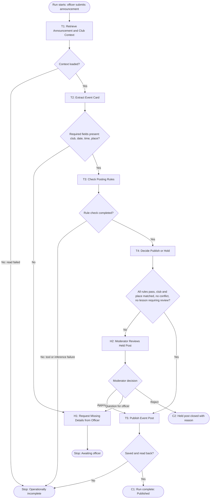

# Workflow of Tasks

## 1. Workflow Overview

### 1.1 Workflow Goal

This workflow supports the system goal defined in `my_first_agent/README.md`: give a club officer a rules-checked event card and a visible decision, published or held with a reason, within 15 minutes of submitting an announcement.

### 1.2 Workflow Trigger

A run begins when a club officer selects **Submit announcement** on the Club Event Radar page after pasting announcement text (a flyer photo may be attached for reference only). The page records the submission with a run ID, the submitting officer's name and club as typed, and the submission time. A duplicate submission of identical text within 10 minutes is recorded as a repeat and does not start a second run. A moderator answer to a held post or an officer reply to a question starts a new bounded run for that one post only; it reuses the saved event card and skips extraction unless the officer changed the announcement text.

### 1.3 Completion Condition at Runtime

Determine the outcome in this order: **incomplete because of an operational error** if a required read, save, or read-back failed; otherwise **awaiting officer** if a required fact (date, time, place, or club) is missing and the officer has been asked a specific question; otherwise **held for moderator** if every required fact is present but a rule is unmet, a club or place cannot be matched, or a moderator lesson requires review; otherwise **published** when every posting rule passes and the published post is confirmed by read-back. A held or awaiting-officer post is a completed, visible decision, not a failure. Completion never means a moderator approved a held post.

### 1.4 General Workflow

The system first performs **T1: Retrieve Announcement and Club Context** to load the submitted text, the club list, the club's earlier posts, the posting rules and campus places, and the enabled moderator lessons. **T2: Extract Event Card** turns the announcement into a structured card (club, title, date, time, place, description, contact) and marks any field the text does not state as missing instead of guessing it. If a required field is missing, **H1: Request Missing Details from Officer** saves one specific question and the run ends as awaiting officer. Otherwise **T3: Check Posting Rules** selects among checking required fields, matching the club and place, comparing with the club's earlier posts, and applying moderator lessons, and returns a rule-check result with evidence. **T4: Decide Publish or Hold** applies a fixed rule: publish only when every rule passes, the club and place are matched, no earlier post conflicts, and no lesson requires review; every other case is held with a reason. An update to the club's earlier post replaces that post instead of adding a second one. **T5: Publish Event Post** saves the card as public and reads it back; if the save or read-back fails, the run is operationally incomplete and nothing is shown as published. Held posts go to **H2: Moderator Reviews Held Post**, where a signed-in moderator approves, rejects, or asks the officer a question. The system never contacts anyone outside the page and never changes event facts on its own.

### 1.5 Workflow Diagram

